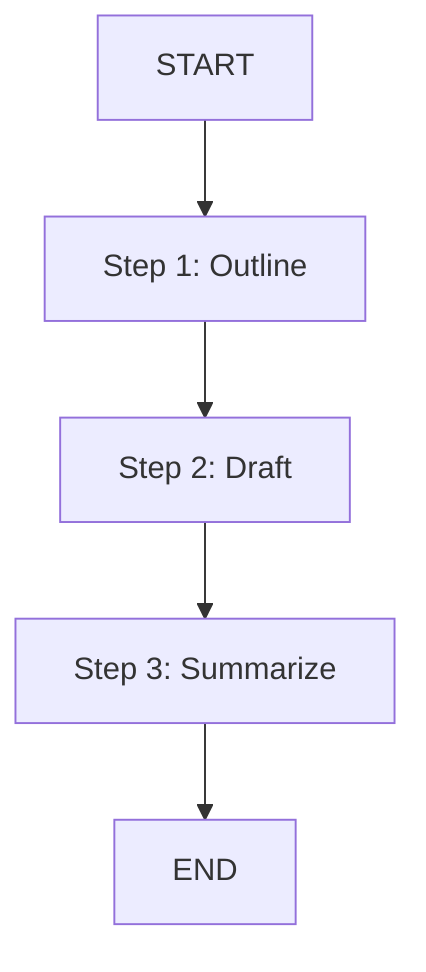

# Architecture: Linear-Sequential

```
[ User Prompt ]
       │
       ▼
┌──────────────────┐
│    LangGraph     │ StateGraph(ChainState)
└────────┬─────────┘
         │
         ▼
┌──────────────────┐
│    LangChain     │ ChatGoogleGenerativeAI (invoke)
└────────┬─────────┘
         │
         ▼
┌──────────────────┐
│  Linear Pipeline │ Outline -> Draft -> Summarize
└──────────────────┘
```


