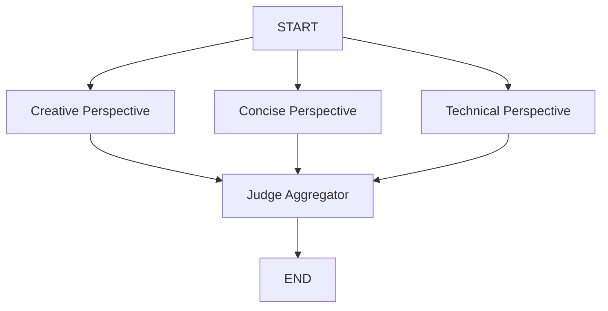

# Architecture: Parallel-Voting

```
[ User Prompt ]
       │
       ▼
┌──────────────────┐
│    LangGraph     │ StateGraph(VotingState)
└────────┬─────────┘
         │
         ▼
┌──────────────────┐
│    LangChain     │ ChatGoogleGenerativeAI (parallel invoke)
└────────┬─────────┘
         │
         ▼
┌──────────────────┐
│ Parallel Fan-Out │ [Creative | Concise | Technical] -> Judge
└──────────────────┘
```


