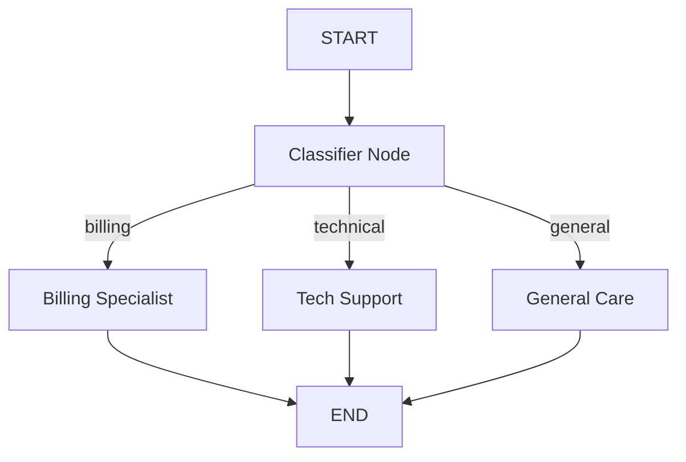

# Architecture: Routing-Classifier

```
[ User Prompt ]
       │
       ▼
┌──────────────────┐
│    LangGraph     │ StateGraph(RoutingState)
└────────┬─────────┘
         │
         ▼
┌──────────────────┐
│    LangChain     │ ChatGoogleGenerativeAI (Classification)
└────────┬─────────┘
         │
         ▼
┌──────────────────┐
│  Dynamic Branch  │ Classifier -> [Billing | Tech | General] -> END
└──────────────────┘
```


