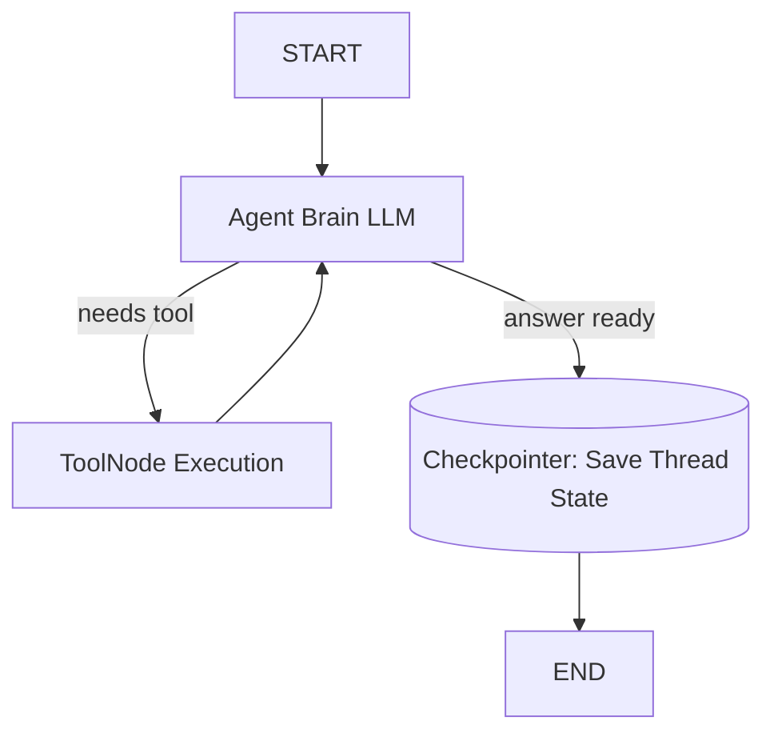

# Architecture: Dynamic-Memory-ReAct

```
[ User Request + Thread ID ]
              │
              ▼
┌──────────────────────────┐
│        LangGraph         │ StateGraph + MemorySaver Checkpointer
└─────────────┬────────────┘
              │
              ▼
┌──────────────────────────┐
│        LangChain         │ ChatGoogleGenerativeAI (tool calling)
└─────────────┬────────────┘
              │
              ▼
┌──────────────────────────┐
│     Multi-Turn Loop      │ Reads past thread checkpoints -> Invokes -> Saves new state
└─────────────┬────────────┘
              │
              ▼
┌──────────────────────────┐
│          Tools           │ lookup_weather
└──────────────────────────┘
```


