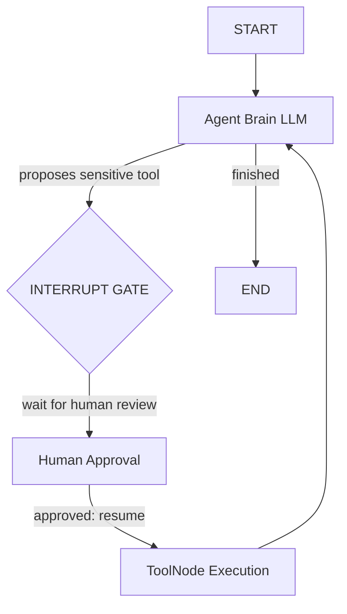

# Architecture: Human-in-the-Loop-Gate

```
[ User Prompt ]
       │
       ▼
┌──────────────────┐
│    LangGraph     │ StateGraph + MemorySaver Checkpoint
└────────┬─────────┘
         │
         ▼
┌──────────────────┐
│    LangChain     │ ChatGoogleGenerativeAI (tool calling)
└────────┬─────────┘
         │
         ▼
┌──────────────────┐
│    HITL Gate     │ Agent -> [ PAUSE: Human Approval Required ] -> Tools -> END
└────────┬─────────┘
         │
         ▼
┌──────────────────┐
│  Sensitive Tool  │ transfer_money (executed only after human OK)
└──────────────────┘
```


