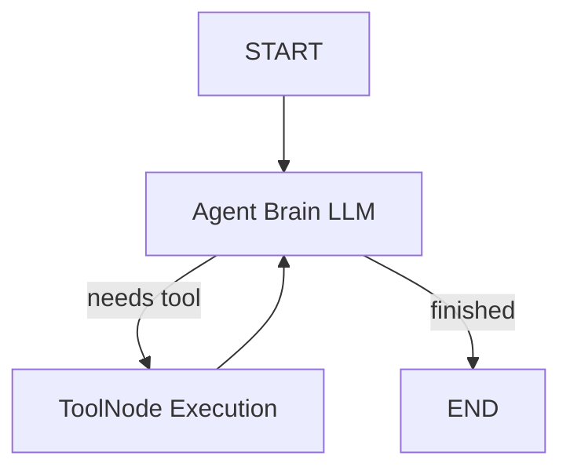

# Architecture: Single-Agent-ReAct

```
[ User Prompt ]
       │
       ▼
┌──────────────────┐
│    LangGraph     │ StateGraph(AgentState)
└────────┬─────────┘
         │
         ▼
┌──────────────────┐
│    LangChain     │ ChatGoogleGenerativeAI + bind_tools
└────────┬─────────┘
         │
         ▼
┌──────────────────┐
│   Agent Loop     │ Agent (LLM) <───► ToolNode (Execution)
└────────┬─────────┘
         │
         ▼
┌──────────────────┐
│     Tools        │ calculate_discount
└──────────────────┘
```


