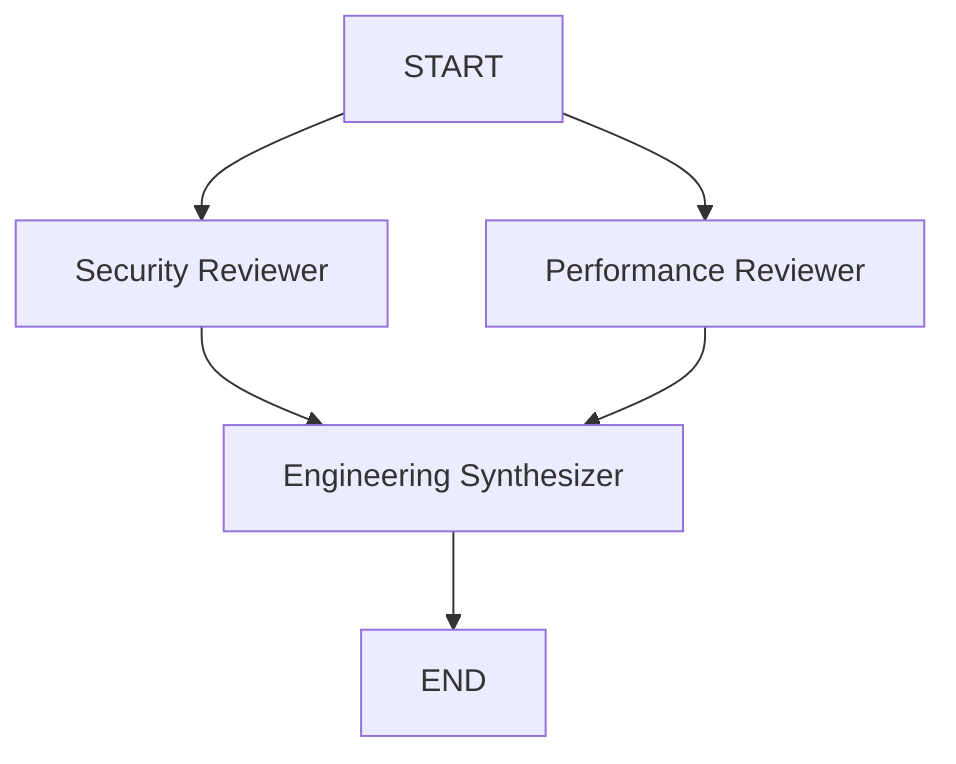

# Architecture: Multi-Perspective-Review

```
[ System Proposal ]
        │
        ▼
┌──────────────────┐
│    LangGraph     │ StateGraph(ReviewState)
└────────┬─────────┘
         │
         ▼
┌──────────────────┐
│    LangChain     │ Security Auditor + Performance Auditor
└────────┬─────────┘
         │
         ▼
┌──────────────────┐
│ Parallel Review  │ [ Security Critique | Perf Critique ] -> Synthesizer -> END
└──────────────────┘
```


