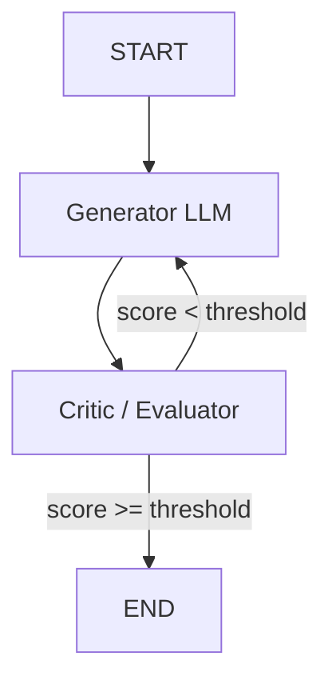

# Architecture: Self-Correction-Loop

```
[ User Task ]
      │
      ▼
┌──────────────────┐
│    LangGraph     │ StateGraph(ReflectionState)
└────────┬─────────┘
         │
         ▼
┌──────────────────┐
│    LangChain     │ Generator LLM + Critic LLM
└────────┬─────────┘
         │
         ▼
┌──────────────────┐
│ Reflection Cycle │ Generate -> Evaluate (Score < 8? -> Loop back with feedback)
└──────────────────┘
```


