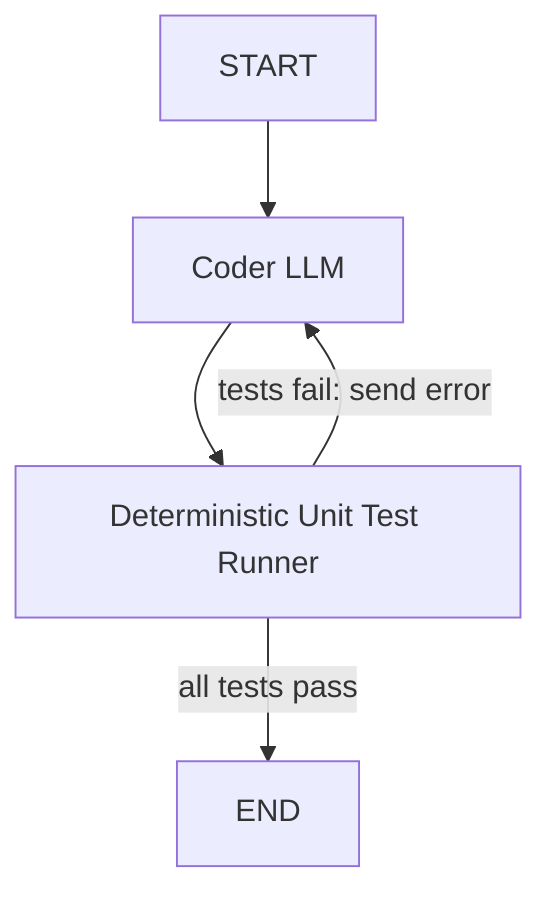

# Architecture: Unit-Test-Driven-Loop

```
[ Code Specification ]
          │
          ▼
┌──────────────────┐
│    LangGraph     │ StateGraph(CodeGenState)
└────────┬─────────┘
         │
         ▼
┌──────────────────┐
│    LangChain     │ Coder LLM (Generates executable functions)
└────────┬─────────┘
         │
         ▼
┌──────────────────┐
│   Test Runner    │ Deterministic Sandbox / Pytest Exec (Fails? -> Feed stacktrace back)
└──────────────────┘
```


