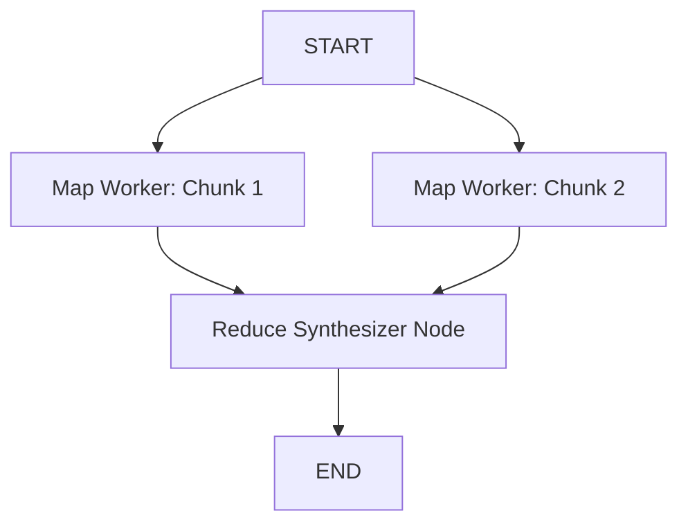

# Architecture: Map-Reduce-FanOut-FanIn

```
[ Large Document Set / Data Chunks ]
                 │
                 ▼
┌─────────────────────────────────┐
│            LangGraph            │ StateGraph(MapReduceState)
└────────────────┬────────────────┘
                 │
                 ▼
┌─────────────────────────────────┐
│            LangChain            │ ChatGoogleGenerativeAI (Map + Reduce)
└────────────────┬────────────────┘
                 │
                 ▼
┌─────────────────────────────────┐
│      Map-Reduce Architecture    │ Map Workers (Chunk 1..N) ──► Reduce Synthesizer ──► END
└─────────────────────────────────┘
```


