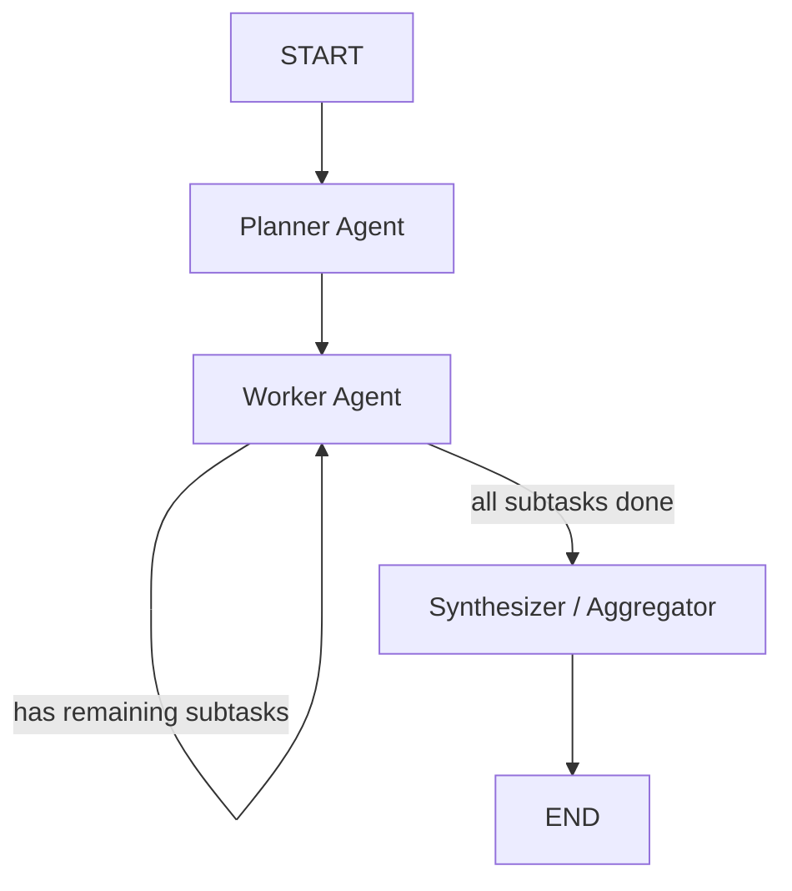

# Architecture: Plan-and-Execute

```
[ Complex User Goal ]
          │
          ▼
┌──────────────────┐
│    LangGraph     │ StateGraph(PlanExecuteState)
└────────┬─────────┘
         │
         ▼
┌──────────────────┐
│    LangChain     │ Planner LLM + Worker LLM
└────────┬─────────┘
         │
         ▼
┌──────────────────┐
│ Plan & Execution │ Planner (Creates Task List) -> Worker Loop (Runs Task 1..N) -> Synthesizer
└──────────────────┘
```


