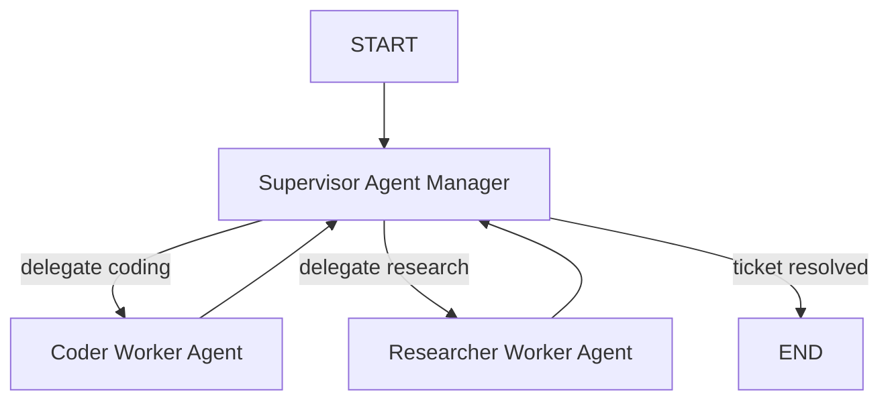

# Architecture: Supervisor-Router

```
[ User Ticket / Task ]
          │
          ▼
┌──────────────────┐
│    LangGraph     │ StateGraph(SupervisorState)
└────────┬─────────┘
         │
         ▼
┌──────────────────┐
│    LangChain     │ Supervisor Manager + Specialized Workers
└────────┬─────────┘
         │
         ▼
┌──────────────────┐
│  Manager Cycle   │ Supervisor <───► [ Coder Agent | Researcher Agent ]
└────────┬─────────┘
         │
         ▼
┌──────────────────┐
│ Finished / Exit  │ Supervisor routes to END when all worker outputs satisfactory
└──────────────────┘
```


