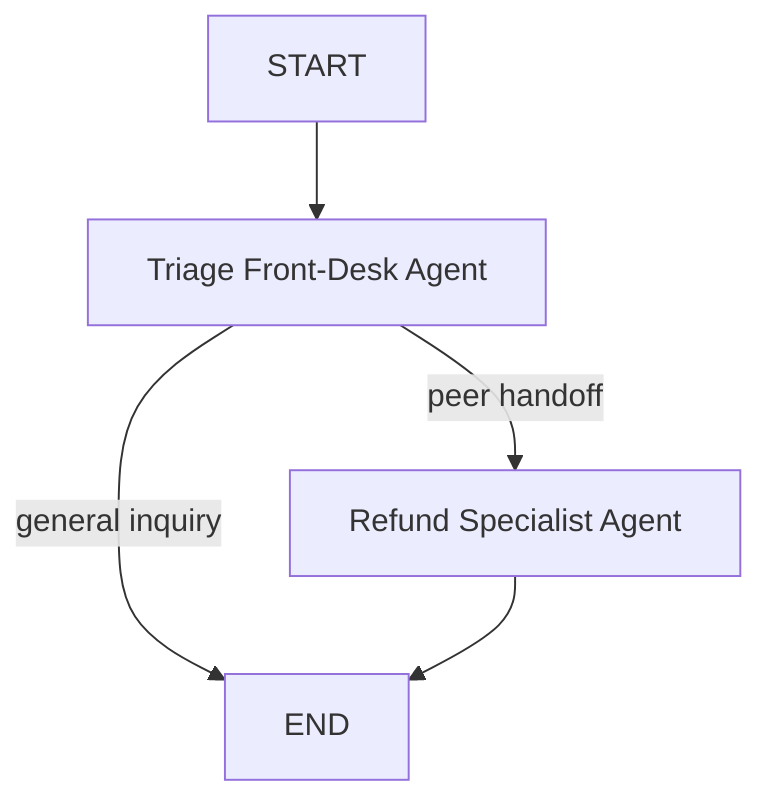

# Architecture: Swarm-Handoff

```
[ User Request ]
       │
       ▼
┌──────────────────┐
│    LangGraph     │ StateGraph(SwarmState)
└────────┬─────────┘
         │
         ▼
┌──────────────────┐
│    LangChain     │ ChatGoogleGenerativeAI (Multi-Persona)
└────────┬─────────┘
         │
         ▼
┌──────────────────┐
│  Peer Handoff    │ Triage Agent ──(Hands Off Context)──► Refund Specialist Agent ──► END
└──────────────────┘
```


