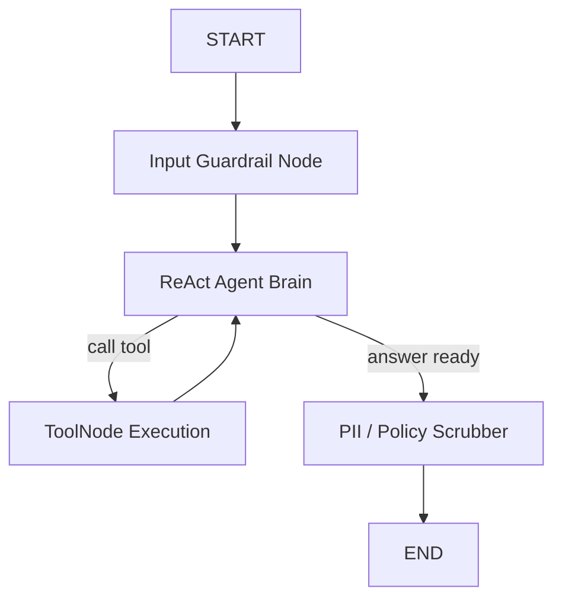

# Architecture: Chain-Wrapped-ReAct

```
[ Raw User Query ]
        │
        ▼
┌───────────────────────┐
│     Input Guard       │ Step 1 (Chain): Validate, authenticate, sanitize prompt
└───────────┬───────────┘
            │
            ▼
┌───────────────────────┐
│      LangGraph        │ Step 2 (Agent): Autonomous ReAct Loop
│  ┌─────────────────┐  │
│  │   Agent Brain   │◄─┼─┐
│  └────────┬────────┘  │ │ Tool Execution
│           ▼           │ │ Cycle
│  ┌─────────────────┐  │ │
│  │    ToolNode     ├──┴─┘
│  └─────────────────┘  │
└───────────┬───────────┘
            │
            ▼
┌───────────────────────┐
│     Output Guard      │ Step 3 (Chain): PII Scrubbing, Compliance & Policy check
└───────────┬───────────┘
            │
            ▼
         [ END ]
```


