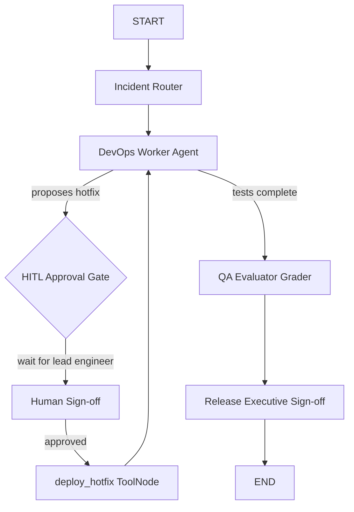

# Architecture: Full-Enterprise-Pipeline

```
[ User Request / Incident ]
            │
            ▼
┌───────────────────────────┐
│       Stage 1: Router     │ Classifies incident & tickets
└─────────────┬─────────────┘
              │
              ▼
┌───────────────────────────┐
│     Stage 2: ReAct Loop   │ Worker Agent analyzes & prepares tool
│ ┌───────────────────────┐ │
│ │   DevOps Specialist   │ │
│ └───────────┬───────────┘ │
│             │             │
│   [ HITL APPROVAL GATE ]  │ ◄── PAUSE: Requires Human Sign-off
│             │             │
│ ┌───────────▼───────────┐ │
│ │   Production Tool     │ │ (deploy_hotfix)
│ └───────────────────────┘ │
└─────────────┬─────────────┘
              │
              ▼
┌───────────────────────────┐
│    Stage 3: QA Evaluator  │ Reflection node verifies health checks
└─────────────┬─────────────┘
              │
              ▼
┌───────────────────────────┐
│    Stage 4: Sign-off      │ Final compliance delivery
└─────────────┬─────────────┘
              │
              ▼
           [ END ]
```


