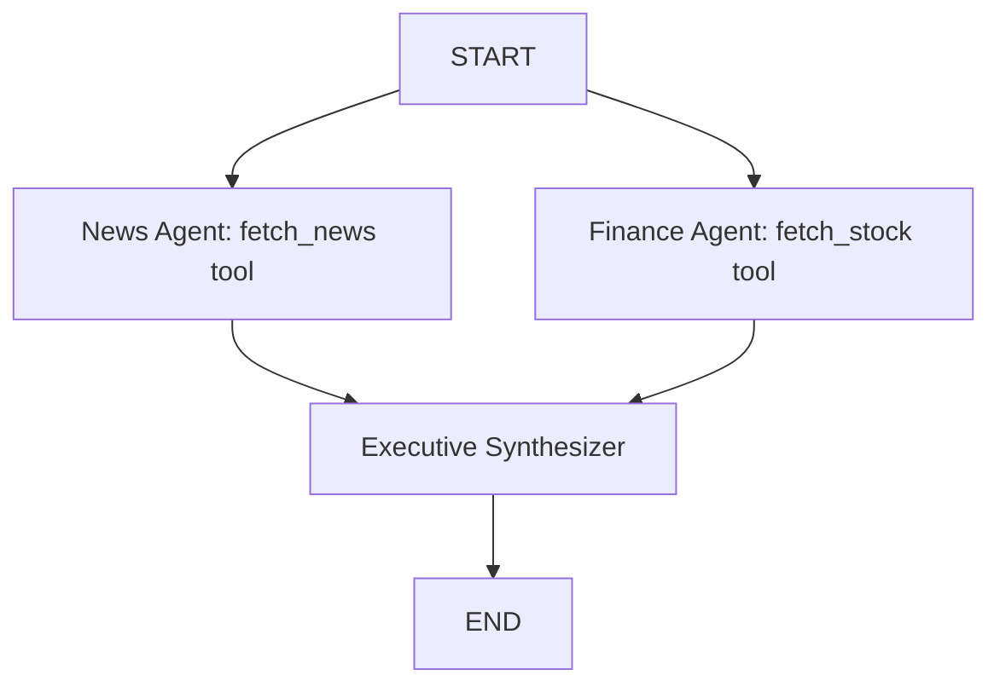

# Architecture: Parallel-ReAct-Swarm

```
[ Target Company / Entity ]
              │
              ▼
┌───────────────────────────┐
│         LangGraph         │ StateGraph(SwarmState)
└─────────────┬─────────────┘
              │
              ▼
┌───────────────────────────┐
│         LangChain         │ Specialized Agents with discrete Tools
└─────────────┬─────────────┘
              │
              ▼
┌───────────────────────────┐
│    Parallel Agent Swarm   │ [ News Agent (Tools) | Financial Agent (Tools) ]
└─────────────┬─────────────┘
              │
              ▼
┌───────────────────────────┐
│        Aggregator         │ Merges parallel agent tool findings into single report
└─────────────┬─────────────┘
              │
              ▼
           [ END ]
```


