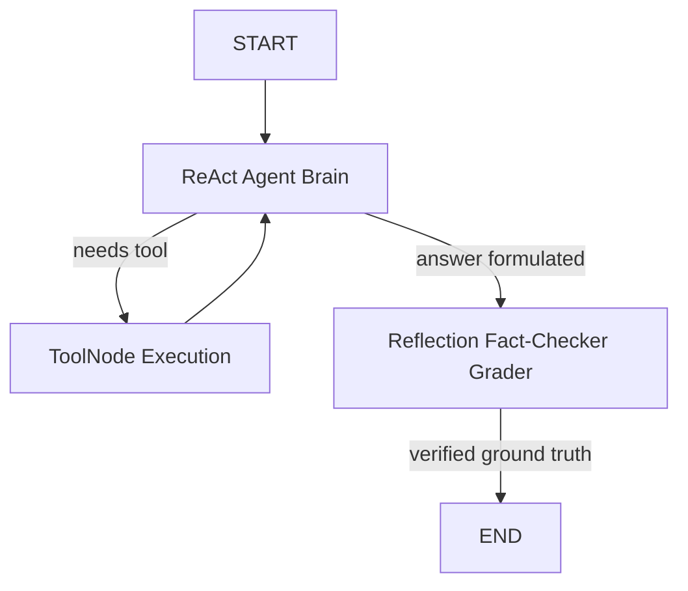

# Architecture: ReAct-with-Reflection

```
[ User Query ]
       │
       ▼
┌──────────────────┐
│    LangGraph     │ StateGraph(State)
└────────┬─────────┘
         │
         ▼
┌──────────────────┐
│    LangChain     │ ChatGoogleGenerativeAI (tool calling + reflection)
└────────┬─────────┘
         │
         ▼
┌──────────────────┐
│    ReAct Loop    │ Agent Brain <───► ToolNode (Retrieval / Action)
└────────┬─────────┘
         │ (Tools finished)
         ▼
┌──────────────────┐
│ Reflection Node  │ Fact-Checker / Hallucination Grader ──► Verified Answer ──► END
└──────────────────┘
```


