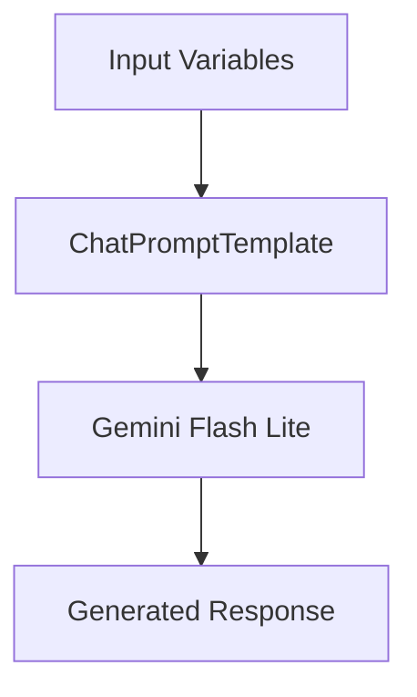

# Architecture: Prompts and Templates

```
[ Input Variables ] (topic="LangChain Prompts")
         │
         ▼
┌──────────────────┐
│ChatPromptTemplate│ Generates System + Human Message objects
└────────┬─────────┘
         │
         ▼
┌──────────────────┐
│    Gemini LLM    │ Low-latency generation (<8 words)
└────────┬─────────┘
         │
         ▼
[ Formatted Output ]
```


