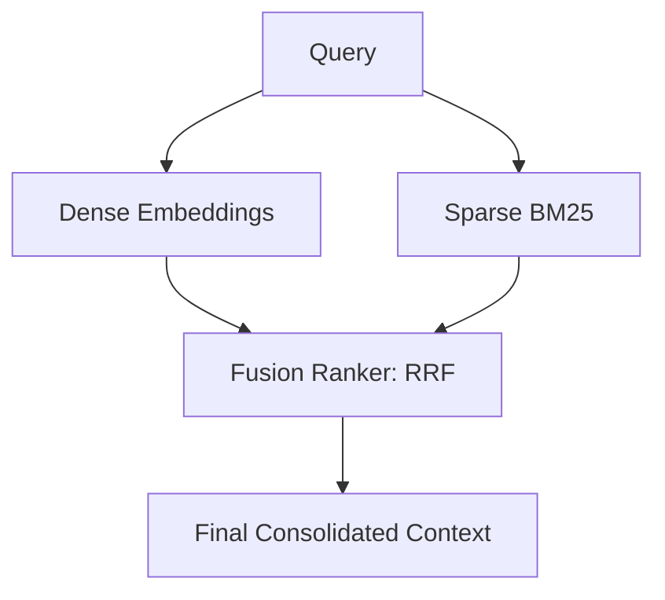

# Architecture: Hybrid Search (Vector + BM25)

```
[ User Query ] ──┬──► [ Dense Vector Search ] ──┐
                 └──► [ Sparse BM25 Keyword ] ──┴──► [ Reciprocal Rank Fusion (RRF) ] ──► [ Winner ]
```


