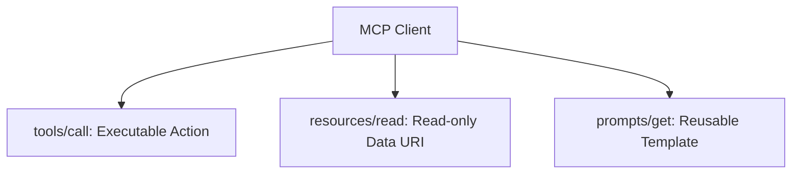

# Architecture: 3 MCP Primitives

```
┌───────────────────────────────────────────────┐
│              MCP Server Daemon                │
│                                               │
│  1. Tools     : Executable actions (call_tool)│
│  2. Resources : Read-only data URIs (read_res)│
│  3. Prompts   : Server prompt templates (get) │
└───────────────────────────────────────────────┘
```


